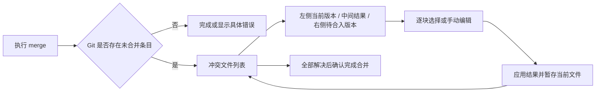

# Git merge 冲突工作区：调研与设计

日期：2026-11-12。状态：用户已确认推荐的内置三栏方案，并授权完整实现、测试和最终 git push。

用户希望在 Helix 执行 git merge 遇到冲突时，像 PyCharm 一样进入窗口处理，并要求先调研、写开发计划。本文件最初用于调研与设计；随后已按确认的方案实现。实际执行证据与平台限制见[验证记录](../2026-11-12-git-merge-conflicts-validation.md)。

## 1. JetBrains 调研

调研依据为当日可访问的官方文档，PyCharm 与 IntelliJ IDEA 的页面均显示 2026.3 Help；未运行这些 IDE，因此不把文档描述当作本机实测。

| 官方行为 | 对 Helix 的启发 |
| --- | --- |
| 检测到冲突后出现文件列表，可以接受整份 Yours / Theirs 或手动处理。 | 需要仓库级入口，不能只有单文件冲突标记跳转。 |
| 手动处理使用三栏：左、右只读，中间编辑结果；中间最初来自共同祖先。 | Base、双方输入、Result 是四份概念上独立的数据。 |
| 可应用非冲突改动，再逐块接受或忽略两侧变化，也可直接编辑中间。 | 自动合并非冲突部分与人工决定冲突块应分开。 |
| 应用结果后可进入下一文件；关闭对话框后仍可从冲突节点继续。 | 会话须支持多文件、暂停和恢复。 |

以上见 [PyCharm Resolve Git conflicts](https://www.jetbrains.com/help/pycharm/resolve-conflicts.html)。[IntelliJ IDEA 的对应说明](https://www.jetbrains.com/help/idea/resolve-conflicts.html)还说明了撤销文件的冲突解决，以及全部处理后完成合并的操作。

[Diff Viewer 官方说明](https://www.jetbrains.com/help/pycharm/differences-viewer.html)提供了冲突窗口周边交互参考：前后差异导航、同步滚动、对齐变化、颜色区分，以及窗口/标签页形态。Helix 首版采用冲突块导航和关联滚动，不要求像素级复刻。

还有一条外部工具路线：Windows 可通过 `pycharm64.exe merge <path1> <path2> [<base>] <output>` 打开合并界面，前提是已有可用安装和启动器。见 [PyCharm 命令行合并工具](https://www.jetbrains.com/help/pycharm/command-line-merge-tool.html)。

## 2. 当前项目的接入位置

以下是本次直接阅读代码确认的情况，而非对上游 Helix 的泛化描述。

| 现有文件/接口 | 现状及影响 |
| --- | --- |
| `helix-vcs/src/log.rs`，以 `git_tools` 模块导出 | `GitRepository::operate()` 已支持 merge、cherry-pick，返回 `Result<String>`；merge 使用 `--no-edit --no-autostash`。 |
| 同文件 `status()`、`GitSnapshot` | 已读 porcelain v1 状态，但没有 index stage、冲突内容或 merge 生命周期模型。 |
| 同文件 `run()`、`begin_operation()` | 已有参数数组、工作树定位、超时/输出限制和按 git_dir 的操作锁，可复用。 |
| `helix-term/src/ui/git/actions.rs` | 操作失败后会刷新并重新载入未修改的可见缓冲区；目前仅显示错误信息，不进入冲突处理。 |
| `helix-term/src/ui/git/{mod.rs,render.rs}` | 已有底部/全屏 GitPanel、取消旧查询及实例/版本检查。 |
| `helix-term/src/commands/git.rs`、`keymap/default.rs` | 已有 `Space v` Git 分组；`Space g` 保持 changed-file picker。 |
| `helix-term/src/ui/editor.rs`、`compositor.rs` | `EditorView` 可渲染真实 Document/View，组件可通过 `editor_area()` 保留编辑区域。 |
| `helix-view/src/document.rs` | 有 Transaction、历史和外部修改检测；`readonly` 主要描述文件权限，不能直接当作禁止编辑的合并面板开关。 |
| `helix-term/tests/test/git_tools.rs`、`git_tools_review.rs` | 已有临时仓库和 TUI 集成测试方法，可以扩充。 |

现有设计 `docs/superpowers/specs/2026-11-11-git-tools-design.md` 明确选择原生 Git 窗口，并把图形化冲突处理留作后续功能。本提案延续这一方向。现有 pull 是 `--ff-only`，不会为了新增冲突 UI 改成 merge/rebase pull。

## 3. 方案比较与建议

| 方案 | 收益 | 代价 | 建议 |
| --- | --- | --- | --- |
| A. 原生冲突列表 + 三栏合并工作区 | 与现有 Git 面板、主题、键盘编辑统一；不要求另装 IDE。 | 需要冲突模型、结果编辑、写盘/暂存和会话管理。 | 推荐，以下计划据此编写。 |
| B. 调用外部 PyCharm / git mergetool | 可以复用成熟合并 UI，开发量较小。 | 依赖安装、启动器、外部进程退出/保存协议；体验跨应用。 | 后续可选集成，不作为首版依赖。 |
| C. 原文件中高亮标记 + 接受一侧 | 改动小，适合快速处理少量冲突。 | 无法同时看两侧和结果，与用户参考的体验差距较大。 | 可作为辅助能力，不能替代主方案。 |

已确认方案中的“窗口”指终端内全屏工作区，使用现有 Helix 编辑器和 TUI。

## 4. 用户流程与界面



### 入口

- 本应用启动的 merge 产生未合并条目：自动切换到冲突列表；首个文件由用户 Enter 打开，避免直接覆盖正在阅读的内容。
- `Space v r` 新增 `git_resolve_conflicts`，随时重新进入；`Space g` 及已有 Git 命令保持原意。
- Git Changes 中固定显示 `Conflicts (N)` 分组，不能把 UU/AA 等条目当普通 patch 使用。
- 外部命令行 merge：打开/刷新 Git 面板或显式入口时扫描；终端 FocusGained 对当前受信任工作树做一次去抖扫描，给出可进入提示，不反复抢焦点。终端不发送焦点事件时仍可手动刷新；不承诺后台实时监控所有仓库。
- 关闭后的旧回调不得重新弹窗；自动打开必须同时匹配发起面板实例、工作树和操作编号。

### 文件列表

显示路径、冲突类型、处理状态，以及当前合并双方的分支名或短提交号。分支无法可靠推导时只显示提交号，不把所有 incoming 都称作“远程”。

状态至少包含：未处理、编辑中、已暂存、已过期、需外部处理。保留本会话已暂存文件的行供查看，但首版不提供重新制造 Git 冲突的“撤销暂存后还原冲突”操作。

### 三栏工作区

```text
 Merge · feature/topic → main       src/example.rs       unresolved 2/5
┌ Current · main [read-only] ┬ Result [editable] ┬ Incoming · topic [read-only] ┐
│ 当前分支内容               │ 最终合并结果       │ 待合入内容                    │
│ 当前冲突范围               │ 当前决策高亮       │ 对应冲突范围                  │
└───────────────────────────┴───────────────────┴──────────────────────────────┘
 [Previous] [Next] [Use Left] [Use Right] [Keep Both] [Base] [Apply] [Files]
```

- 默认全屏；宽度至少 120 列且高度至少 18 行时，内容区按约 30% / 40% / 30% 排列。更窄时切换 Current / Result / Incoming 标签，仍使用同一份结果和决策；低于 8 行给出精简操作提示。
- Base 作为临时只读查看模式，不占第四常驻栏。两侧是只读预览组件，不是可修改的普通文件缓冲区。
- 中间是专用无路径 Document，复用 Helix 输入、选择、搜索、语法高亮、undo/redo。合并初始化以自动合并结果为起点；冲突块显示 base 内容（AA 则为空）且保持“未决定”，不会因为结果没有标记就算解决。
- 无冲突变化默认保留。这与 PyCharm 可配置的起始应用方式不同，目的是减少重复操作；首版不做行内“简单冲突”猜测。
- Use Left / Use Right 只替换当前冲突块；Keep Both 固定按左后右排列，标题提示顺序。整文件 Accept Current / Incoming 放在独立菜单并确认，明确会舍弃另一侧所有改动。
- 手工编辑后选择 `Mark Reviewed`；任何影响该块的后续编辑（含 undo/redo）重新标记为待复核。有待决定/复核的块时 Apply 不可用。
- 跳转冲突时三栏定位对应范围；滚动跟随基于行映射，不能使用相同绝对行号。首版不要求像 JetBrains 一样逐行补空白对齐。
- 合并动作使用结果区 Normal 模式下的 `Space v m` 子菜单：`n/p` 前后块、`l/r/b` 左/右/两边、`v` 查看 Base、`m` 复核、`a` 应用、`f` 文件列表。Insert 模式保留原输入语义；鼠标按钮执行同一动作。`q` 只在工具栏/列表表示返回，不能劫持结果编辑区的宏命令。

### 应用、暂停和完成

- 编辑只改变草稿。`Apply result and stage` 校验版本后写入并仅暂存当前路径；清空所有未合并条目后仍须独立确认 `Finish Merge`。
- 应用成功后的结果草稿只读，保持显示内容与已暂存内容一致。同一路径再次出现冲突时，旧草稿标为过期，须明确确认刷新后读取新的来源。
- 专用结果 Document 的普通保存/自动保存不得绕过上述流程；`:w` 显示明确提示使用 Apply。首版不支持在此 Document 中 `:w <path>` 改绑路径。
- 自动保存静默跳过合并草稿；`:wa` 保存其它文档并报告未应用的合并草稿。结果窗口中的 `:q`/关闭缓冲区返回原工作区并保留草稿，显式强制关闭才放弃该草稿；应用退出仍检查所有有修改的草稿。打开其它文件、切换缓冲区或使用窗口布局命令时，先保留草稿并离开合并工作区，再执行原命令，不能把其它文件误显示为 Result。
- 返回文件列表/关闭工作区时保留草稿在本次进程内，可以再次进入；明确放弃才移除有修改的草稿。退出应用沿用未保存文档检查。首版不增加崩溃恢复格式，也不声称未应用的草稿在重启后存在。
- 重新打开时，若工作文件已有人工修改，默认保留当前工作文件为结果草稿，进入整文件人工复核模式；不自动用重新生成的结果替换它。用户可明确选择“从双方重新构建”，此时先确认放弃已有结果。
- 应用失败分为“未写入”和“已写入、暂存失败”。后一种保留结果，允许只重试暂存，不能显示已解决或自动回滚用户内容。
- Finish Merge 展示将提交的全部 staged 路径、双方提交和 Git 默认合并说明；包含非冲突的自动合并文件。确认后使用 `git commit --no-edit` 完成已有 MERGE_HEAD 的合并，正常运行用户 hooks；不自动 push。
- Abort Merge 为独立确认操作，调用 `git merge --abort`；有草稿/未保存缓冲区时先处理它们，命令失败保留现场。它不保证还原 merge 前所有未提交改动，不能用 hard reset 兜底。此边界依据 [Git merge 文档](https://git-scm.com/docs/git-merge)。

## 5. Git 数据与实现边界

### 从 index 建模

`git ls-files --unmerged -z` 提供路径、mode、OID、stage；按 NUL 分隔并保留原始路径，仅显示时转义控制字符。stage 1/2/3 分别是 base/current/incoming，缺失 stage 用 Option 表达，不能伪装为空文件；内容按 OID 用 `cat-file` 读取。见 [git-ls-files](https://git-scm.com/docs/git-ls-files) 和 [git-merge 的冲突状态定义](https://git-scm.com/docs/git-merge)。

仓库状态通过实际工作树 git_dir 下的 MERGE_HEAD、CHERRY_PICK_HEAD、rebase 状态和 index 检测。不得假定 `.git` 是目录；复用现有工作树发现。冲突检测不匹配 stderr 的英文 `CONFLICT`。专用结果文档没有路径，因此活跃会话里的 Git 命令必须从会话取得工作树，不能退回进程 cwd。

### 合并模型

- 使用 Git `merge-file --stdout --diff3` 对临时输入计算候选结果，避免自写三方合并算法；复用已有 workspace `tempfile` 包，将它加入该 crate 的运行依赖即可，不引入新包。
- marker-size 取大于所有输入中相关行首标记最长连续长度的值；使用固定、受控的 side labels，仅解析这次生成的完整标记结构。源码内本就存在的 `<<<<<<<` 不是解决状态的依据。
- 退出码 0 是干净结果，1..127 是冲突数量而非普通失败；其他退出/超时是错误。解析出的真实数量独立计数，处理超过 127 块。见 [git-merge-file](https://git-scm.com/docs/git-merge-file)。
- 正常 UU 和 AA 的普通 UTF-8 文本进入逐块模式。UTF-8 BOM、LF/CRLF、EOF 无换行须往返保留；三份输入的比较可规范化换行，输出依据工作文件已识别的格式编码。混合换行或格式来源不明确时降级人工处理，不静默整文件改格式。
- 工作文件只有在与候选结果语义一致时才初始化逐块视图；可忽略 Git 生成标记的标签/标准 merge、diff3、zdiff3 表达差异，不能忽略正文差异。难以可靠对应时保留工作文件并降级整文件复核，优先避免丢掉之前的手改。
- Document 变更通过 ChangeSet 映射块的结果区间；输入区间保持不变。重叠/跨块修改不能继续使用旧偏移；标记需复核，范围不能无歧义恢复时降级整文件复核。undo/redo 也走此路径，重新确认比保留过期“已解决”状态更安全。

### 首版支持矩阵

| 场景 | 首版行为 |
| --- | --- |
| 常规 merge 的 UU、AA、普通文本内容冲突 | 三栏、逐块决策、手改、应用并暂存、完成/取消 merge。 |
| 已有人工修改、Git rerere 生成的内容 | 保留当前结果，整文件复核后显式暂存；不把无标记等同已解决。 |
| modify/delete、rename/delete、路径重命名/目录冲突 | 列出真实 index 路径和缺失侧，首版不代做删除/重命名决策；外部完成后刷新。仅内容冲突且路径无需变更的文件可按该路径处理，不推测重命名配对。 |
| 二进制、symlink、submodule、非 UTF-8、混合换行 | 显示类型和处理提示，不通过有损解码生成可写结果。 |
| 自定义 merge driver、filter、working-tree-encoding | 保留工作文件，禁用自动重建/写入；首版引导外部处理，避免绕过转换语义。 |
| 单份输入或结果超过 2 MiB / 50,000 行 | 停止三栏加载，保留冲突列表及外部处理提示；仍遵守现有 16 MiB 命令输出上限。 |
| rebase、cherry-pick、stash 或无 MERGE_HEAD 的 unmerged index | 识别并展示，首版不提供 merge 的完成/取消按钮或猜测双方语义；后续阶段增加相应 resolver。 |

rebase 下 ours/theirs 的含义与直觉可能相反，不能只翻译成“我的/别人的”；后续支持时显示操作角色和提交号。[Git checkout 官方解释](https://git-scm.com/docs/git-checkout)。

### 写入与并发

每个文件快照携带 opaque token，包含 canonical git_dir、HEAD、merge parents、对应 index stages/modes、工作文件内容/文件类型状态。应用前在现有仓库操作锁内重读比较；过期就停止，保留草稿。git_dir 锁用于应用内串行化，不能假定它锁住外部 Git 进程。

对支持的普通文件，使用同目录临时文件和现有 metadata/atomic-save 惯例替换；保留权限。写后复查磁盘内容再 `git add -- <exact-path>`，之后重新读取 index，确认该路径 unmerged entries 已消失且 stage-0 对应所写内容。绝不 `git add .`。其它已暂存路径不被改写。

保存期间冻结本草稿编辑；普通编辑器中同路径存在脏缓冲区时阻止应用。更新/重新载入所有匹配路径的干净缓冲区，不能仅依赖当前可见视图。并发外部写入采用乐观校验并报告检测到的不一致，不承诺跨文件系统和 Git index 的原子事务。

完成确认另持有 HEAD、merge parents、index tree 和默认合并说明的 token；如果确认后 staged 内容改变，必须重新预览。取消合并同样重查操作身份。有超时/失败时刷新真实状态，而非推断成功。

## 6. 组件边界

- `helix-vcs/src/log/conflicts.rs`：公开类型、无 git feature stub 与 GitRepository 冲突 API；实现子模块在现有 `implementation` 内复用命令 runner 和操作锁。
- `helix-vcs/src/log/conflicts_backend.rs`：index/操作状态、内容、merge-file、应用、完成/取消；不要把所有代码继续堆进 log.rs。
- `helix-vcs/src/merge.rs`：合并文本/区间的纯模型、候选结果解析和范围映射，复用已有 helix-core / imara-diff。
- `helix-view/src/merge.rs`：结果 Document 与会话注册、草稿生命周期和临时 editor Tree 的保存/恢复。原布局移动保存，避免把 Tree/ViewId 随意重建；恢复后再按当前终端尺寸 resize。
- `helix-term/src/ui/git/conflicts.rs`：列表、文件状态及完成/取消确认。
- `helix-term/src/ui/git/merge/{mod.rs,render.rs}`：顶部动作、两侧只读预览、窄屏模式与鼠标操作。中央区域交给现有 EditorView，不实现第二套文本编辑器。
- `helix-term/src/handlers/git_conflicts.rs`：异步发现与过期回调处理。活跃 merge workspace 期间暂停 GitPanel 的占区/事件，不让两个组件重复裁剪 editor_area。

## 7. 全局约束

- 使用 Rust 1.90、现有 Tokio/Helix TUI/Git CLI；不新增第三方包，允许复用 workspace 中已有 tempfile。
- 保留 Space g 和既有 Space v 入口；新增 Space v r，合并动作位于 Space v m。
- pull 保持 --ff-only --no-autostash；merge 保持 --no-autostash；不增加隐式 stash、force、hard reset 或自动 push。
- 所有 Git 读写遵守现有 workspace trust、参数数组、路径验证、操作锁、20 秒查询/60 秒操作和 16 MiB 输出限制。
- 所有编辑、写盘和暂存必须绑定同一工作树及快照；不把清除标记视为解决，不暂存其它路径。
- 首版仅写入普通 merge 的受支持 UTF-8 文本；其它情况明确降级，保留原始数据。
- 保持 git feature 关闭时可编译；变更用临时仓库验证，不在用户仓库制造冲突。

## 8. 验收与后续

首版的完成标准：临时仓库中从现有 Git 菜单 merge 开始，出现列表，至少两个冲突文件能混用选边与手改，经 Apply 验证实际 index，最后确认产生双父提交；退出/重开、窄屏、外部修改和失败重试均不丢草稿或误暂存。

后续独立阶段：modify/delete 与整文件二进制选边；重命名组合决策；rebase/cherry-pick 的 continue/skip/abort；已解决文件回退；更精细的行内差异和对齐；可配置外部 mergetool。它们不作为首版已实现能力宣传。

可由实现者决定的细节：现有主题 scope 的具体复用、列表列宽与截断、内部缓存容器和测试 fixture 命名。支持范围、写入规则和交互入口变更应回到本设计说明。
